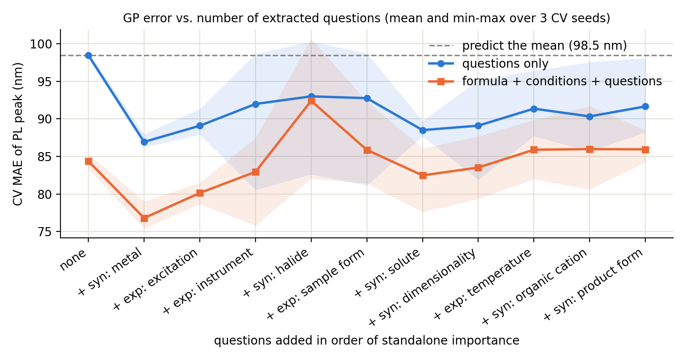
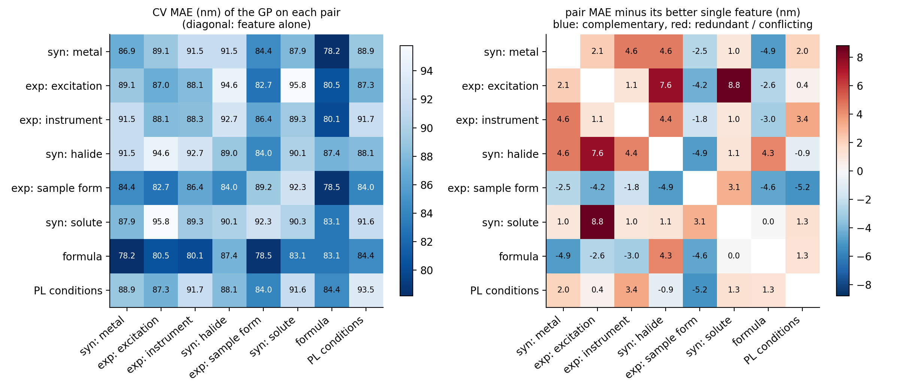
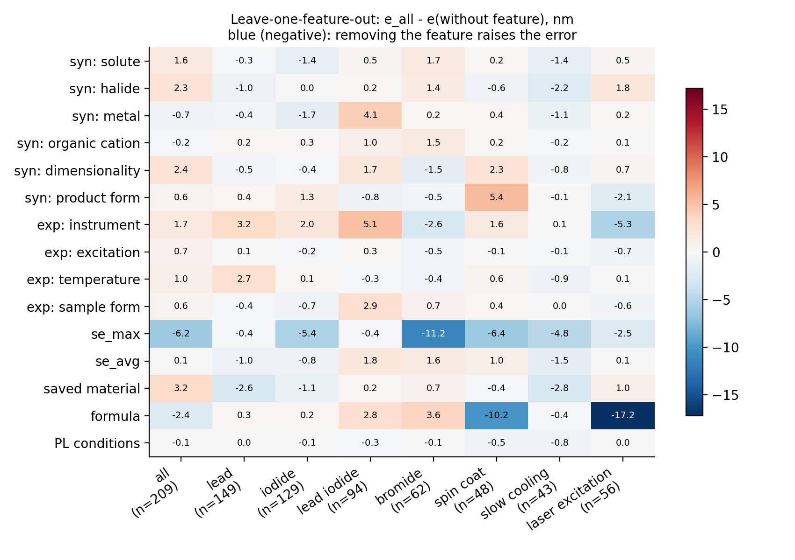

# Self-improving Agentic Loops using Gaussian Processes Conditioned on LLM Extracted Features For Materials Property Prediction

## Motivation

Knowledge graphs extracted by agents from papers rarely have ground truth or measurable error metrics, which prevents them from improving themselves. However, given one reliable extracted feature, such as the curated peak photoluminescence $y_i$, we can use conditioned Gaussian processes to estimate the quality of the extracted features in a knowledge graph. The held-out error of a GP that predicts $y$ from the extracted features is a metric the agent can see and minimize.

## Approach

1. **Hybrid search.** [HybriD3](https://materials.hybrid3.duke.edu/) records (formula, synthesis text, experimental text, PL peak) are scraped into structured records and indexed in Postgres/pgvector. BM25 sparse vectors and dense embeddings (BAAI/bge-small-en-v1.5) are fused with reciprocal rank fusion. For a query $q$, each record $d$ gets
   $$\mathrm{RRF}_q(d) = \sum_{r \in \{\text{BM25},\, \text{dense}\}} \frac{1}{\kappa + \mathrm{rank}_r(d \mid q)},$$
   where $\kappa$ is a constant (commonly 60). The relevant set $\mathcal{D}_q$ is the top-$M$ records by this score. *In the experiments below, $\mathcal{D}_q$ is a regex filter on the record fields, standing in for hybrid search.*

2. **Agentic questions.** An agent breaks the reference synthesis into targeted questions $Q = \{q_1, \dots, q_K\}$ (solvents, solution temperature, duration…). A deterministic extractor (regex rules, or a local LLM via Ollama) also produces fixed facets: precursors, solvents, additives, method, product form and atmosphere.

3. **Question-by-question scoring.** An LLM answers each question for the reference and for every record ([KG-GP-Embed](https://huggingface.co/spaces/svenpvoigt/KG-GP-Embed)), $a_{ik} = \mathrm{LLM}(d_i, q_k)$. Each answer is embedded and normalized, $v_{ik} = \phi(a_{ik}) / \lVert \phi(a_{ik}) \rVert$. Each record gets one similarity score per question,
   $$x_{ik} = v_{ik}^\top v_{\mathrm{ref},k}, \qquad x_i = (x_{i1}, \dots, x_{iK}) \in [-1, 1]^K.$$
   The fixed facets give a per-facet similarity tensor $S \in \mathbb{R}^{N \times N \times Q}$ with $S_{ijk} = v_{ik}^\top v_{jk}$. Each slice $S_{::k} = V_k V_k^\top \succeq 0$ is a Gram matrix, so each slice is a valid kernel.

4. **Iterative Gaussian process.** The similarity scores are the GP inputs and PL is the target ([KG-GP-Condition](https://huggingface.co/spaces/svenpvoigt/KG-GP-Condition_OSI)). The kernel is an RBF with one lengthscale per question, plus noise:
   $$k(x, x') = \sigma_f^2 \exp\!\Big(-\tfrac12 \sum_{k=1}^{K} \frac{(x_k - x'_k)^2}{\ell_k^2}\Big) + \sigma_n^2\, \delta_{xx'}.$$
   The hyperparameters $\eta = (\sigma_f, \ell_{1:K}, \sigma_n)$ maximize $\log p(\mathbf{y} \mid X, \eta) = -\tfrac12 \mathbf{y}^\top \tilde K^{-1} \mathbf{y} - \tfrac12 \log |\tilde K| - \tfrac N2 \log 2\pi$. Conditioning on the training records gives, for a held-out record,
   $$\mu_* = k_*^\top \tilde K^{-1} \mathbf{y}, \qquad \sigma_*^2 = k_{**} - k_*^\top \tilde K^{-1} k_*,$$
   scored on held-out records $T$ by
   $$\mathrm{RMSE} = \sqrt{\tfrac{1}{|T|} \textstyle\sum_{i \in T} (y_i - \mu_i)^2}, \qquad \mathrm{MAE} = \tfrac{1}{|T|} \textstyle\sum_{i \in T} |y_i - \mu_i|, \qquad \mathrm{Cov}_{2\sigma} = \tfrac{1}{|T|} \textstyle\sum_{i \in T} \mathbb{1}\big[|y_i - \mu_i| \le 2\sigma_i\big].$$
   This is the score the agent improves by rewriting its questions. *In the experiments below, the inputs are the answer embeddings themselves, $x_i^{(k)} = v_{ik} \in \mathbb{R}^{1024}$, with ARD over every dimension. A formula element matcher, the PL measurement conditions and MatSciBERT embeddings are added, and the score is MAE over 5 folds × 3 seeds.*

5. **Agentic loop: updating features from the CV error.** Let $e(Q; \mathcal{D}_q)$ be the CV error of the GP conditioned on the answers to question set $Q$ over records $\mathcal{D}_q$. The agent is shown finite-difference "gradients" of $e$ with respect to each question:
   $$\Delta_k^+ = e(\{q_k\}) - e(\varnothing), \qquad \Delta_k^- = e(Q) - e(Q \setminus \{q_k\}).$$
   $\Delta_k^+ < 0$ means the answers to $q_k$ carry signal about $y$ on their own. $\Delta_k^- < 0$ means $q_k$ adds information that no other question provides. From $(e, \Delta^\pm)$ and sample answers, the agent proposes $Q'$: it drops questions with $\Delta_k^- > 0$, rewrites questions with $\Delta_k^+ \ge 0$ (e.g. to ask for value-only answers), and adds questions for properties nothing covers yet. The update is accepted only if the paired improvement over CV seeds $s$ exceeds the noise:
   $$\bar\delta = \tfrac{1}{|\Sigma|} \textstyle\sum_{s} \big[e_s(Q_t) - e_s(Q')\big] > 2\, \mathrm{SE}_s(\delta) \;\Rightarrow\; Q_{t+1} = Q'.$$
   This is greedy coordinate descent over the question set, with $\Delta$ in the role of the gradient. **Queries** are chosen the same way. The agent picks retrieval queries $q$ whose local GP lowers the error, $q^\star = \arg\min_{q:\, |\mathcal{D}_q| \ge n_{\min}} e(Q; \mathcal{D}_q)$. The per-query $\Delta^\pm(q)$ then show which questions matter *within* that family. A question that is constant on $\mathcal{D}_q$ must get $\Delta \approx 0$, which gives a free check on the extraction. Predicting with the GP of the query a record matches gives a mixture of local GPs, which suits a stationary kernel better than one global fit across chemistries.

## Results

Prototype results on small example sets, not yet the full HybriD3 scrape:

- **Composition leakage.** Whole-paragraph embeddings largely encode composition rather than synthesis. The halide dominates PL, so text similarity partly acts as a composition proxy. That's why we split the synthesis into targeted queries and treat composition as a separate input.
- **Long answers inflate similarity.** Long LLM answers share boilerplate ("The text specifies that…"), so the solvent question barely separated a shared solvent (DMF, 0.69) from no overlap at all (0.65). Value-only answers are next.
- **The loop runs end to end:** questions → similarity → GP fit → held-out error.

On 209 HybriD3 records with a PL peak (this repository, 10 agent-written questions plus reference features; MAE in nm, mean of 3 CV seeds):

- **Fewer, sharper questions win.** Adding questions one at a time in order of $\Delta^+$ (Fig. 1), the first question (metal) cuts the error from 98.5 to 86.9 nm, or from 84.4 to 76.8 nm on top of formula and PL conditions. No later step gets back below the one-question error, and with all ten questions the errors end at 91.7 and 85.9 nm. The loop has to prune, not just accumulate, which is why the update rule drops questions with $\Delta^- > 0$.
- **The error landscape shows redundancy and complementarity** (Fig. 2). The best pairs are formula + metal (78.2 nm) and formula + sample form (78.5 nm). Sample form complements almost every other field. Formula + halide is redundant (+4.3 nm over the better single feature), consistent with composition leakage. Excitation + solute conflict (+8.8 nm).
- **Queries lower the error and specialize the questions** (Table 1, Fig. 3). Process queries improve on their own baseline by 30–52%, against 17% for all records. Within "iodide", the halide question gets $\Delta^- = 0.00$, as it must. Within "lead iodide", the organic cation becomes the best single question ($\Delta^+ = -14.2$).
- **CV noise sets the acceptance threshold.** A single split moves the full-feature score by up to 15 nm, so the accept step needs paired, multi-seed CV. Changes with $|\Delta^-| \lesssim 3$ nm are not distinguishable from noise.

**Table 1.** A query, then a local GP, then the per-question ablation.

| Query | n | Mean (nm) | GP (nm) | Gain | Most unique ($\Delta^-$) |
|---|--:|--:|--:|--:|---|
| all | 209 | 98.5 | 81.5 | 17% | `se_max` (−6.2) |
| lead | 149 | 86.5 | 73.6 | 15% | saved material (−2.6) |
| iodide | 129 | 84.1 | 69.4 | 17% | `se_max` (−5.4) |
| lead iodide | 94 | 77.1 | 74.6 | 3% | product form (−0.8) |
| bromide | 62 | 80.9 | 72.1 | 11% | `se_max` (−11.2) |
| spin coat | 48 | 103.6 | 72.6 | 30% | formula (−10.2) |
| slow cooling | 43 | 85.4 | 41.0 | 52% | `se_max` (−4.8) |
| laser excitation | 56 | 102.4 | 63.3 | 38% | formula (−17.2) |

**Fig. 1.** GP error as questions are added in order of standalone gain (mean and min–max over 3 seeds).

**Fig. 2.** Error landscape over pairs of the top features. Left: pair MAE. Right: pair MAE minus its better single feature (blue means complementary).

**Fig. 3.** $\Delta^-$ for every feature and query (blue means the feature helps).

*Caveats:* the question order in Fig. 1 and the best pairs in Fig. 2 are selected on the same CV, so their errors are optimistic. Records from the same paper can fall on both sides of a split; grouped CV by paper is next.
