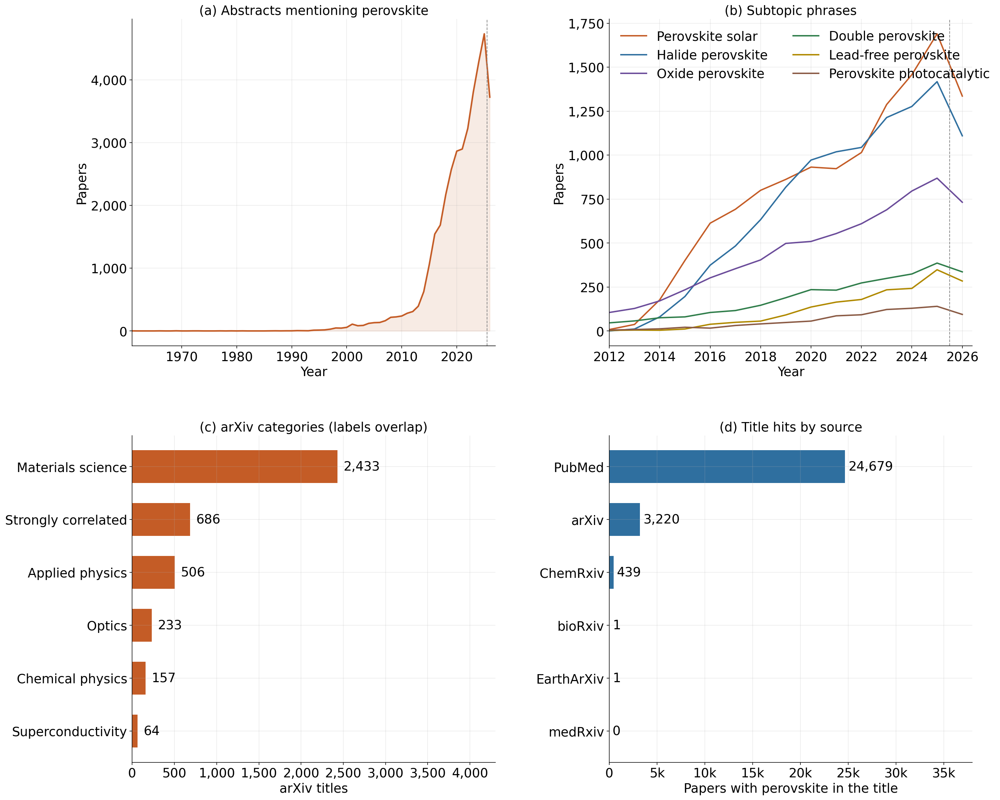

# **SALEM**: **S**elf-improving **A**gentic **L**oops: LLM-**E**xtracted features for **M**aterials Property Prediction

## **Motivation**
The growing volume of scientific literature on perovskite materials highlights both the increasing importance of this research area and the challenges of systematically extracting reliable knowledge from it. As shown in Fig. (a), the number of abstracts mentioning perovskites has increased substantially over the past two decades, reaching 4,732 papers in 2025. The distribution across subtopics in Fig. (b) further illustrates the diversity of the field, with solar and halide-related research gaining prominence over oxide-related studies after 2014, while topics such as double perovskites, lead-free compositions, and photocatalysis remain comparatively less represented. This diversity is also reflected in the arXiv title distribution in Fig. (c), where materials science accounts for 2,433 of the 3,220 identified titles, although individual titles may belong to multiple categories. As shown in Fig. (d), the search yields 28,340 title matches across PubMed (24,679), arXiv (3,220), and ChemRxiv (439), demonstrating the substantial scale of the literature that must be processed to construct a comprehensive knowledge graph.

This rapid growth and increasing diversity of the literature motivate the need for automated methods that can assess and improve the reliability of knowledge extracted by AI agents. Since curated ground truth is generally unavailable for most extracted features, conventional error metrics cannot be readily applied to evaluate the resulting knowledge graphs. However, when at least one reliable reference property is available, such as the curated peak photoluminescence $y_i$, a Gaussian process (GP) can be conditioned on this property to evaluate the predictive consistency of other extracted features. The held-out prediction error of the GP then provides a measurable signal of extraction quality, enabling agents to identify potentially unreliable features and iteratively improve their extraction strategies. In this way, the proposed approach transforms a limited amount of curated data into a practical, quantitative feedback mechanism for self-improving knowledge graph construction.

## **Approach**

1. **Hybrid search.** [HybriD3](https://materials.hybrid3.duke.edu/) records (formula, synthesis text, experimental text, PL peak) are scraped into structured records and indexed in Postgres/pgvector. BM25 sparse vectors and dense embeddings (BAAI/bge-small-en-v1.5) are fused with reciprocal rank fusion. For a query $q$, each record $d$ gets

   $$\mathrm{RRF}_q(d) = \sum_{r \in \{\text{BM25},\, \text{dense}\}} \frac{1}{\kappa + \mathrm{rank}_r(d \mid q)},$$

   where $\kappa$ is a constant (commonly 60). The relevant set $\mathcal{D}_q$ is the top-$M$ records by this score. *In the experiments below, $\mathcal{D}_q$ is a regex filter on the record fields, standing in for hybrid search.*

2. **Agentic questions.** An agent breaks the reference synthesis into targeted questions $Q = \{q_1, \dots, q_K\}$ (solvents, solution temperature, duration…). A deterministic extractor (regex rules, or a local LLM via Ollama) also produces fixed facets: precursors, solvents, additives, method, product form and atmosphere.

3. **Question-by-question scoring.** An LLM answers each question for the reference and for every record ([KG-GP-Embed](https://huggingface.co/spaces/svenpvoigt/KG-GP-Embed)), $a_{ik} = \mathrm{LLM}(d_i, q_k)$. Each answer is embedded and normalized, $v_{ik} = \phi(a_{ik}) / \lVert \phi(a_{ik}) \rVert$. Each record gets one similarity score per question,

   $$x_{ik} = v_{ik}^\top v_{\mathrm{ref},k}, \qquad x_i = (x_{i1}, \dots, x_{iK}) \in [-1, 1]^K.$$

   The fixed facets give a per-facet similarity tensor $S \in \mathbb{R}^{N \times N \times Q}$ with $S_{ijk} = v_{ik}^\top v_{jk}$. Each slice $S_{::k} = V_k V_k^\top \succeq 0$ is a Gram matrix, so each slice is a valid kernel.

4. **Iterative Gaussian process.** The similarity scores are the GP inputs and PL is the target ([KG-GP-Condition](https://huggingface.co/spaces/svenpvoigt/KG-GP-Condition_OSI)). The kernel is an RBF with one lengthscale per question, plus noise:

   $$k(x, x') = \sigma_f^2 \exp\!\Big(-\tfrac12 \sum_{k=1}^{K} \frac{(x_k - x'_k)^2}{\ell_k^2}\Big) + \sigma_n^2\, \delta_{xx'}.$$

   The hyperparameters $\eta = (\sigma_f, \ell_{1:K}, \sigma_n)$ maximize $\log p(\mathbf{y} \mid X, \eta) = -\tfrac12 \mathbf{y}^\top \tilde K^{-1} \mathbf{y} - \tfrac12 \log |\tilde K| - \tfrac N2 \log 2\pi$. Conditioning on the training records gives, for a held-out record,

   $$\mu_* = k_*^\top \tilde K^{-1} \mathbf{y}, \qquad \sigma_*^2 = k_{**} - k_*^\top \tilde K^{-1} k_*,$$

   scored on held-out records $T$ by

   $$\mathrm{RMSE} = \sqrt{\tfrac{1}{|T|} \textstyle\sum_{i \in T} (y_i - \mu_i)^2}, \qquad \mathrm{MAE} = \tfrac{1}{|T|} \textstyle\sum_{i \in T} |y_i - \mu_i|, \qquad \mathrm{Cov}_{2\sigma} = \tfrac{1}{|T|} \textstyle\sum_{i \in T} \mathbb{1}\big[|y_i - \mu_i| \le 2\sigma_i\big].$$

   This is the score the agent improves by rewriting its questions. *In the experiments below, the inputs are the answer embeddings themselves, $x_i^{(k)} = v_{ik} \in \mathbb{R}^{1024}$, with ARD over every dimension. A formula element matcher, the PL measurement conditions and MatSciBERT embeddings are added, and the score is MAE over 5 folds × 3 seeds.*

5. **Agentic loop: updating features from the CV error.** Let $e(Q; \mathcal{D}_q)$ be the CV error of the GP conditioned on the answers to question set $Q$ over records $\mathcal{D}_q$. The agent is shown finite-difference "gradients" of $e$ with respect to each question:

   $$\Delta_k^+ = e(\{q_k\}) - e(\varnothing), \qquad \Delta_k^- = e(Q) - e(Q \setminus \{q_k\}).$$

   $\Delta_k^+ < 0$ means the answers to $q_k$ carry signal about $y$ on their own. $\Delta_k^- < 0$ means $q_k$ adds information that no other question provides. From $(e, \Delta^\pm)$ and sample answers, the agent proposes $Q'$: it drops questions with $\Delta_k^- > 0$, rewrites questions with $\Delta_k^+ \ge 0$ (e.g. to ask for value-only answers), and adds questions for properties nothing covers yet. The update is accepted only if the paired improvement over CV seeds $s$ exceeds the noise:

   $$\bar\delta = \tfrac{1}{|\Sigma|} \textstyle\sum_{s} \big[e_s(Q_t) - e_s(Q')\big] > 2\, \mathrm{SE}_s(\delta) \;\Rightarrow\; Q_{t+1} = Q'.$$

   This is greedy coordinate descent over the question set, with $\Delta$ in the role of the gradient. **Queries** are chosen the same way. The agent picks retrieval queries $q$ whose local GP lowers the error, $q^\star = \arg\min_{q:\, |\mathcal{D}_q| \ge n_{\min}} e(Q; \mathcal{D}_q)$. The per-query $\Delta^\pm(q)$ then show which questions matter *within* that family. A question that is constant on $\mathcal{D}_q$ must get $\Delta \approx 0$, which gives a free check on the extraction. Predicting with the GP of the query a record matches gives a mixture of local GPs, which suits a stationary kernel better than one global fit across chemistries.

## Results

Prototype results on small example sets, not yet the full HybriD3 scrape as shown in **Fig. 0**:

- **Composition leakage.** Whole-paragraph embeddings largely encode composition rather than synthesis. The halide dominates PL, so text similarity partly acts as a composition proxy. That's why we split the synthesis into targeted queries and treat composition as a separate input.

- **Long answers inflate similarity.** Long LLM answers share boilerplate ("The text specifies that…"), so the solvent question barely separated a shared solvent (DMF, 0.69) from no overlap at all (0.65). Value-only answers are next.

- **The loop runs end to end:** questions → similarity → GP fit → held-out error.

On 209 HybriD3 records with a PL peak (this repository, 10 agent-written questions plus reference features; MAE in nm, mean of 3 CV seeds):

- **Fewer, sharper questions win.** Adding questions one at a time in order of $\Delta^+$ (Fig. 1), the first question (metal) cuts the error from 98.5 to 86.9 nm, or from 84.4 to 76.8 nm on top of formula and PL conditions. No later step gets back below the one-question error, and with all ten questions the errors end at 91.7 and 85.9 nm. The loop has to prune, not just accumulate, which is why the update rule drops questions with $\Delta^- > 0$.

- **The error landscape shows redundancy and complementarity** (Fig. 2). The best pairs are formula + metal (78.2 nm) and formula + sample form (78.5 nm). Sample form complements almost every other field. Formula + halide is redundant (+4.3 nm over the better single feature), consistent with composition leakage. Excitation + solute conflict (+8.8 nm).

- **Queries lower the error and specialize the questions** (Fig. 0, Fig. 3). Process queries improve on their own baseline by 30–52%, against 17% for all records. Within "iodide", the halide question gets $\Delta^- = 0.00$, as it must. Within "lead iodide", the organic cation becomes the best single question ($\Delta^+ = -14.2$).

- **CV noise sets the acceptance threshold.** A single split moves the full-feature score by up to 15 nm, so the accept step needs paired, multi-seed CV. Changes with $|\Delta^-| \lesssim 3$ nm are not distinguishable from noise.

## **Future Applications** 
It is a challenging task to report different type of properties for a material in one research paper. Therefore, our proposed approach can assist in identifying relevant feature vectors that can be used to create property specific predictive GP models. These models can help in calculating missing property values for the materials that exist in the knowledge base, thereby completing their materials tetrahedron.